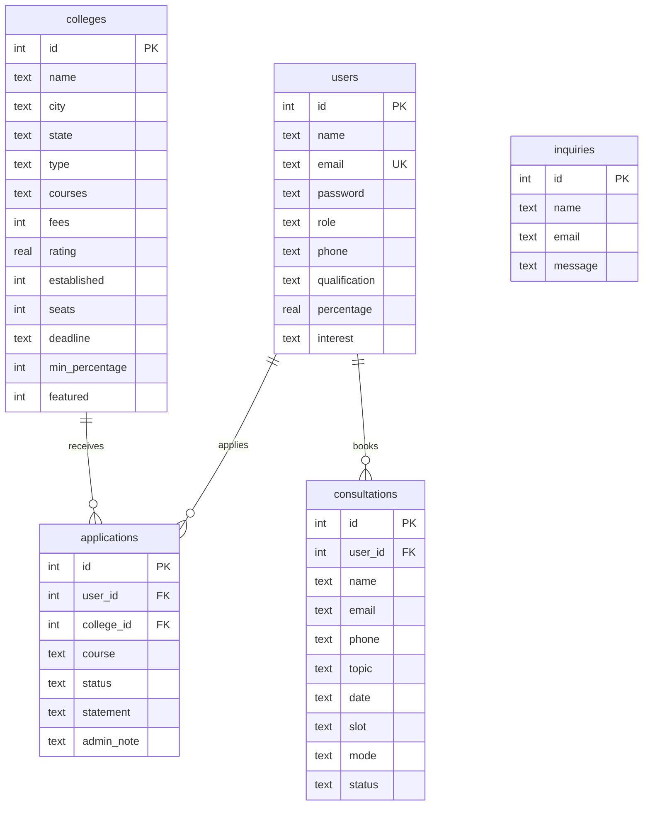

<p align="center">
  <strong style="font-size:2em">E</strong>
</p>

<h1 align="center">Educonsult</h1>

<p align="center">
  <b>A full-stack Educational Consultancy & College Admission Management Platform</b><br>
  <sub>Discover colleges · Book free counselling · Apply & track admissions — all in one place.</sub>
</p>

<p align="center">
  
  
  
  
  
</p>

---

## ✨ Highlights

- 🎨 **Premium UI** — Hand-crafted navy & gold design system, fully responsive, with smooth scroll-reveal animations
- ⚡ **Zero build step** — No bundlers, no frameworks, no transpilers. Pure HTML / CSS / JS served by Express
- 🔐 **Secure by default** — bcrypt-hashed passwords, signed JWTs, parameterised SQL, role-based access control
- 🗃️ **Self-contained** — SQLite database auto-created and seeded on first run. No external services needed
- 🧩 **RESTful API** — Clean, well-structured endpoints powering both the public site and admin panel

---

## 🚀 Quick Start

```bash
# 1. Install dependencies
npm install

# 2. Start the server
npm start

# 3. Open in your browser
#    → http://localhost:3000
```

> **Requires** Node.js 18 or higher. The SQLite database (`data.db`) is created and seeded automatically on first run with 12 sample colleges and demo accounts.

---

## 🔑 Demo Credentials

| Role      | Email                    | Password     |
|-----------|--------------------------|--------------|
| 🛡️ Admin   | `admin@educonsult.com`   | `admin123`   |
| 🎓 Student | `student@educonsult.com` | `student123` |

---

## 📋 Features

### 🌐 Public Website
- **Landing page** with live stats, featured colleges, testimonials, and a "how it works" flow
- **College directory** with real-time search, filters (stream, state, fees), and sorting
- **College detail pages** with course info, eligibility, deadlines, and one-click apply
- **Free counselling booking** — pick a date, time slot, and mode (online / in-person)
- **Contact form** for general inquiries

### 🎓 Student Dashboard
- Register / login with secure authentication
- Apply to colleges and track application status in real time
- View counsellor notes and status updates (Submitted → Under Review → Admitted)
- Manage counselling sessions (book, view, cancel)
- Edit academic profile (qualification, percentage, interests)

### 🛡️ Admin Panel
- **Overview dashboard** with live stats, application-by-status charts, and top-applied colleges
- **Application management** — review, change status, add counsellor notes
- **Consultation management** — confirm, complete, or cancel booked sessions
- **College CRUD** — add, edit, delete institutions with full details
- **Student directory** — view all registered users and their application counts
- **Inquiry inbox** — read and manage contact form submissions

---

## 🏗️ Architecture

```
educonsult/
├── server.js            # Express REST API + static file server
├── db.js                # SQLite schema, migrations & seed data
├── package.json         # Dependencies & scripts
├── data.db              # Auto-generated SQLite database
│
└── public/              # Static frontend (served by Express)
    ├── index.html       # Landing page
    ├── colleges.html    # College directory with search & filters
    ├── college.html     # Individual college detail + apply
    ├── book.html        # Free counselling booking form
    ├── contact.html     # Contact / inquiry form
    ├── login.html       # Login & registration (tabbed)
    ├── dashboard.html   # Student dashboard
    ├── admin.html       # Admin panel
    │
    ├── css/
    │   └── style.css    # Complete design system (navy / gold / ivory)
    │
    └── js/
        └── app.js       # Shared client library (auth, API, nav, toasts, helpers)
```

---

## 📡 API Reference

### Authentication
| Method | Endpoint                 | Description              | Auth |
|--------|--------------------------|--------------------------|------|
| POST   | `/api/auth/register`     | Create a new account     | —    |
| POST   | `/api/auth/login`        | Log in, receive JWT      | —    |
| GET    | `/api/me`                | Get current user profile | ✅    |
| PUT    | `/api/me`                | Update profile           | ✅    |

### Colleges
| Method | Endpoint              | Description                                  | Auth    |
|--------|-----------------------|----------------------------------------------|---------|
| GET    | `/api/colleges`       | List all (supports `q`, `state`, `type`, `maxFees`, `sort`, `featured`) | —       |
| GET    | `/api/colleges/meta`  | Get available states & types for filters     | —       |
| GET    | `/api/colleges/:id`   | Get single college details                   | —       |
| POST   | `/api/colleges`       | Add a new college                            | 🛡️ Admin |
| PUT    | `/api/colleges/:id`   | Update a college                             | 🛡️ Admin |
| DELETE | `/api/colleges/:id`   | Delete a college                             | 🛡️ Admin |

### Applications
| Method | Endpoint                | Description                     | Auth     |
|--------|-------------------------|---------------------------------|----------|
| POST   | `/api/applications`     | Submit a new application        | ✅        |
| GET    | `/api/applications`     | List applications (scoped)      | ✅        |
| PUT    | `/api/applications/:id` | Update status & notes           | 🛡️ Admin  |
| DELETE | `/api/applications/:id` | Withdraw (student) or delete    | ✅        |

### Consultations
| Method | Endpoint                     | Description                     | Auth     |
|--------|------------------------------|---------------------------------|----------|
| POST   | `/api/consultations`         | Book a counselling session      | Optional |
| GET    | `/api/consultations`         | List sessions (scoped)          | ✅        |
| GET    | `/api/consultations/slots`   | Check available slots for a date| —        |
| PUT    | `/api/consultations/:id`     | Update session status           | ✅        |

### Inquiries & Stats
| Method | Endpoint              | Description                       | Auth     |
|--------|-----------------------|-----------------------------------|----------|
| POST   | `/api/inquiries`      | Submit a contact form message     | —        |
| GET    | `/api/inquiries`      | List all inquiries                | 🛡️ Admin  |
| DELETE | `/api/inquiries/:id`  | Delete an inquiry                 | 🛡️ Admin  |
| GET    | `/api/stats/public`   | Public stats (colleges, students) | —        |
| GET    | `/api/stats/admin`    | Full admin dashboard stats        | 🛡️ Admin  |
| GET    | `/api/users`          | List all users                    | 🛡️ Admin  |

---

## 🗄️ Database Schema



---

## ⚙️ Configuration

| Variable     | Default                              | Description                        |
|-------------|--------------------------------------|------------------------------------|
| `PORT`      | `3000`                               | Server port                        |
| `JWT_SECRET`| `educonsult-dev-secret-change-me`    | Secret for signing JWTs — **change this in production** |

```bash
# Example: run on a custom port with a secure secret
PORT=8080 JWT_SECRET="my-super-secret-key" npm start
```

---

## 🔒 Security

- **Passwords** — Hashed with bcrypt (10 salt rounds)
- **Sessions** — Signed JWTs with 7-day expiry
- **SQL injection** — All queries use parameterised statements
- **Access control** — Role-based middleware (`auth()`, `adminOnly`) on every protected route
- **Input validation** — Server-side sanitisation and email format checks

---

## 🛠️ Tech Stack

| Layer      | Technology                        |
|------------|-----------------------------------|
| Runtime    | Node.js 18+                       |
| Framework  | Express 4.x                       |
| Database   | SQLite via `better-sqlite3`       |
| Auth       | `jsonwebtoken` + `bcryptjs`       |
| Frontend   | Vanilla HTML / CSS / JavaScript   |
| Design     | Custom CSS design system (no frameworks) |

---

## 📄 License

This project is provided as-is for educational and demonstration purposes.
# EduConsult

